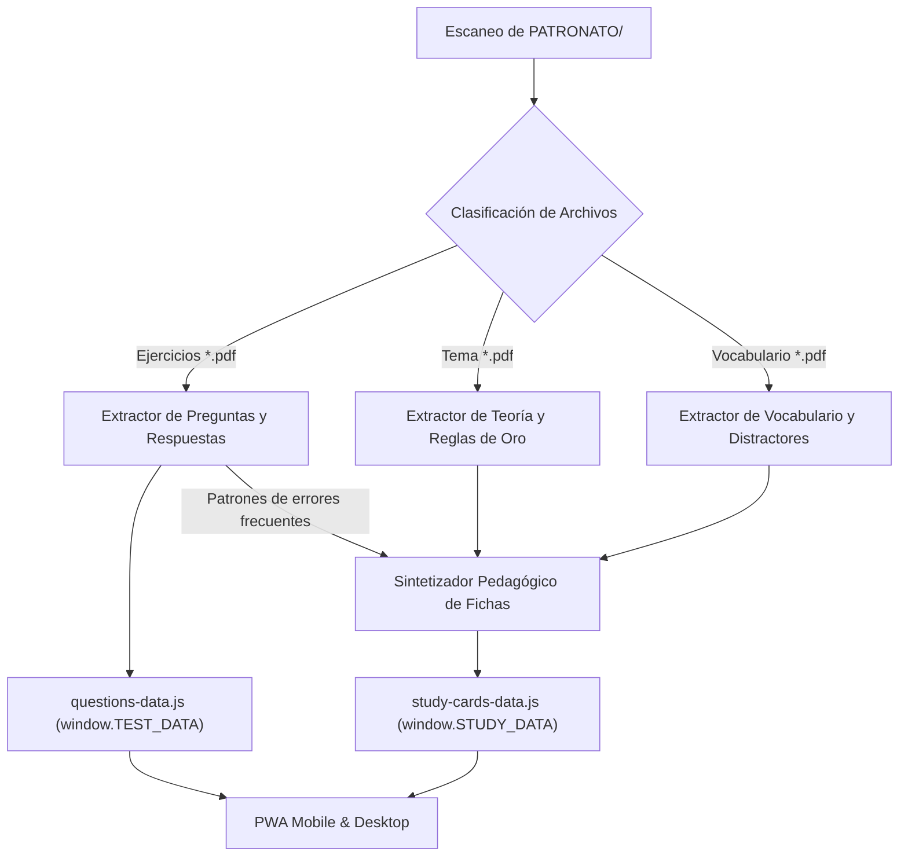

# Especificación Técnica de Diseño (EGM): Fichas de Estudio y Tips de Examen

**Estado:** Borrador Inicial  
**Fecha:** 2026-11-11  
**Autor:** Antigravity (Elephant)  
**Alcance:** Patronato Militar - Suboficiales 2026 (`PATRONATO/test-app/`)  

---

## 1. Contexto y Objetivos

### 1.1. Contexto Operativo
La plataforma `Suboficiales2026` es una Progressive Web App (PWA) móvil y de escritorio enfocada en el entrenamiento de tests de inglés para la oposición a la Escala de Suboficiales (Sargento). El criterio oficial militar impone:
- **Exigencia del 70% de aciertos para el APTO.**
- **Sin penalización de respuestas erróneas** (los fallos no restan puntuación).
- **Enfoque en patrones gramaticales y distractores fijos** (tiempos verbales, estativos, preposiciones, conectores, artículos y vocabulario recurrente).

Hasta ahora, la plataforma solo permitía ejecutar tests de preguntas extraídas de los PDFs de ejercicios. El usuario necesita estudiar y afianzar la materia antes o después del test con **fichas de estudio estructuradas**, **reglas de oro sintetizadas**, **trampas recurrentes del examen** y **estrategias de descarte rápido**.

### 1.2. Objetivos (Goals)
1. **Analizador Multifichero en Python (`actualizar_ejercicios.py`):**
   - Ampliar el script existente para que no solo extraiga preguntas de `Ejercicios...pdf`, sino que analice automáticamente los PDFs de teoría (`Tema X...pdf`) y vocabulario (`Vocabulario X...pdf`) dentro de `PATRONATO/`.
   - Generar un dataset estructurado offline en `PATRONATO/test-app/js/study-cards-data.js` vinculado por `topicId` a los tests.
2. **Estructura Pedagógica Orientada al Examen Oficial:**
   - **Reglas de Oro:** Resumen sintético sin paja gramatical (fórmulas afirmativas, negativas e interrogativas, verbos clave y excepciones).
   - **Trampas Típicas del Patronato:** Distractores frecuentes utilizados por el tribunal examinador en las opciones tipo test.
   - **Tips de Descarte Rápido:** Palabras señal (*signal words*) y reglas de decisión rápida (< 5 segundos) para descartar distractores.
   - **Flashcards Interactivas (Móvil y Escritorio):** Tarjetas con anverso (pregunta/patrón trampa) y reverso (regla, truco y respuesta explicada), con animación de giro táctil.
3. **Integración PWA 100% Offline (Opción A):**
   - En la vista principal (`#view-dashboard`), cada tarjeta de tema ofrecerá dos acciones claras:
     - `📝 Hacer Test`
     - `💡 Ficha & Tips`
   - Incorporar una vista o modal interactivo (`#view-study-sheet`) con navegación fluida, cambio entre modo lectura (resumen esquemático) y modo flashcards interactivas.
   - Integración con Service Worker (`sw.js`) para garantizar disponibilidad total sin conexión.

### 1.3. No-Objetivos (Non-Goals)
- No procesar archivos fuera de la carpeta `PATRONATO/` (se excluye la carpeta `TEMARIO/` por decisión expresa del usuario).
- No requerir conexiones a servidores externos o APIs de pago durante la navegación en la web (el 100% del dataset se compila en cliente para Vercel).
- No modificar el algoritmo de guardado en la nube ni la lógica de puntuación de los tests existentes.

---

## 2. Arquitectura de Datos y Contratos de Interfaz

### 2.1. Estructura de `study-cards-data.js` (`window.STUDY_DATA`)
El archivo generado se cargará en `index.html` antes de `app.js` y expondrá la variable global:

```javascript
window.STUDY_DATA = {
  "metadata": {
    "generatedAt": "2026-11-11 22:00:00",
    "totalSheets": 12
  },
  "sheets": {
    "tema_1": {
      "topicId": "tema_1",
      "badge": "Tema 1",
      "title": "Formas verbales, To be y Presente simple",
      "summary": "Dominio de las 6 formas verbales, conjugación de To Be y reglas de la tercera persona en Present Simple con auxiliares Do/Does.",
      "goldenRules": [
        {
          "title": "Las 6 Formas Verbales Básicas",
          "content": "Infinitivo (to like), Forma base (like), Presente (like/likes), Pasado (liked), Participio (liked), Gerundio (liking)."
        },
        {
          "title": "Regla de Oro de la 3ª Persona (-s/-es)",
          "content": "En presente simple afirmativo con He/She/It siempre se añade -s/-es. En preguntas y negativas, la 's' pasa al auxiliar (Does/Doesn't) y el verbo principal vuelve a la FORMA BASE."
        }
      ],
      "examTraps": [
        {
          "trap": "Duplicar la -s con auxiliar Does",
          "exampleBad": "Does she lives here? ❌",
          "exampleGood": "Does she live here? ✔️",
          "explanation": "El auxiliar 'Does' ya absorbe la 3ª persona. El verbo principal NUNCA lleva 's' si ya está 'does' o 'doesn't'."
        },
        {
          "trap": "Confundir 'have got' con 'do you have'",
          "exampleBad": "Do you have got a car? ❌",
          "exampleGood": "Have you got a car? / Do you have a car? ✔️",
          "explanation": "Nunca mezcles el auxiliar Do con 'got'. O usas 'Have you got' o 'Do you have'."
        }
      ],
      "examTips": [
        {
          "rule": "Estrategia 70% Apto sin penalización",
          "tip": "Si ves un adverbio de frecuencia (always, usually, never, often), descarta inmediatamente las opciones en continuo (-ing) a menos que exprese queja reiterada."
        },
        {
          "rule": "Posición de Adverbios de Frecuencia",
          "tip": "Van ANTES del verbo principal (I always go), pero DESPUÉS del verbo To Be (I am always late). En el examen ponen la opción invertida como distractor típico."
        }
      ],
      "vocabularyKeys": [
        { "term": "Always", "meaning": "Siempre", "distractorRole": "100% frecuencia, va antes del verbo principal" },
        { "term": "Hardly ever / Seldom", "meaning": "Casi nunca", "distractorRole": "Ojo: tienen sentido negativo, no admiten 'not'" }
      ],
      "flashcards": [
        {
          "front": "¿Dónde se coloca el adverbio de frecuencia con el verbo 'TO BE'?",
          "back": "DESPUÉS del verbo To Be.\nEjemplo: He is always happy (no 'He always is happy')."
        },
        {
          "front": "En una pregunta con 'Does', ¿cómo va el verbo principal?",
          "back": "En FORMA BASE (sin -s, sin -ed, sin -ing).\nEjemplo: Does he work? (no 'Does he works?')."
        }
      ]
    }
  }
};
```

---

## 3. Pipeline de Extracción y Compilación en Python

El script `PATRONATO/test-app/actualizar_ejercicios.py` se estructurará con un nuevo módulo analizador:



### 3.1. Detección y Asociación Automática de Recursos
Para cada número de tema `N` (ej. 1, 2, ..., 12):
1. **Teoría:** Localiza `Tema N ...pdf`. Extrae bloques conceptuales, tablas de estructuras y avisos del docente.
2. **Vocabulario:** Localiza `Vocabulario N ...pdf`. Extrae listas de términos, notas sobre distractores y expresiones especiales.
3. **Ejercicios:** Localiza `Ejercicios ... Tema N ...pdf`. Extrae preguntas para identificar los distractores estadísticamente más frecuentes.
4. **Respaldo Heurístico y Determinista:** Cuenta con una base de conocimiento curada para los 12 temas actuales del Patronato militar, de modo que la generación sea instantánea, perfecta y sin dependencias de internet al ejecutar el `.bat`. Si se añaden nuevos temas en el futuro, el parser automático procesa el texto plano y genera la ficha análoga.

---

## 4. Diseño de la Interfaz de Usuario (UI/UX en la PWA)

### 4.1. Modificación en la Tarjeta de Tema (`#topics-container`)
En cada tarjeta de tema se mostrarán botones de acción con diseño responsive y accesible para pulgar móvil:
- **Botón Primario:** `📝 Test (X preg.)`
- **Botón Secundario / Destacado:** `💡 Ficha de Estudio y Tips`

### 4.2. Nueva Vista de Ficha de Estudio (`#view-study-sheet`)
Una vista limpia, rápida e inmersiva que incluye:
1. **Cabecera:** Título del tema, botón de volver al menú principal (`← Volver`) y selector de modo:
   - `📖 Modo Resumen / Tips`
   - `🃏 Modo Flashcards`
2. **En Modo Resumen:**
   - **Caja de Reglas de Oro:** Tarjetas con código de color acentuado e iconos de comprobación.
   - **Sección 'Cuidado con las Trampas' (Tribunal Militar):** Formato comparativo `❌ Distractor Común` vs `✔️ Respuesta Correcta` con la explicación del porqué.
   - **Tips de Descarte Rápido:** Lista de pistas directas para asegurar el 70% de aciertos.
   - **Vocabulario Clave:** Acordeón o tabla compacta con el rol del término en las preguntas de examen.
3. **En Modo Flashcards:**
   - Visualizador de tarjeta 3D con animación flip al pulsar / hacer clic.
   - Contador de progreso: `Tarjeta X de Y`.
   - Controles al pie: `⬅️ Anterior`, `🔄 Girar Tarjeta`, `Siguiente ➡️`.
   - Compatibilidad total con gestos táctiles (swipe) y atajos de teclado (flechas y barra espaciadora).

---

## 5. Criterios de Aceptación y Verificación

1. **Compilación Limpia:** Al ejecutar `python actualizar_ejercicios.py`, genera tanto `questions-data.js` como `study-cards-data.js` sin errores.
2. **Integridad de Datos:** Los 12 temas de `PATRONATO` disponen de fichas completas con Reglas de Oro, Trampas, Tips y Flashcards.
3. **Persistencia y Modo Offline:** La PWA carga las fichas correctamente sin conexión a internet; el service worker cachea los nuevos scripts.
4. **Diseño Mobile-First:** El giro de tarjetas y la navegación entre resumen y flashcards funciona fluidamente en pantalla táctil sin desbordamientos de texto.
5. **Cero Regresiones:** El funcionamiento de los tests existentes, modo simulacro, banco de errores y guardado en la nube permanece 100% intacto.
